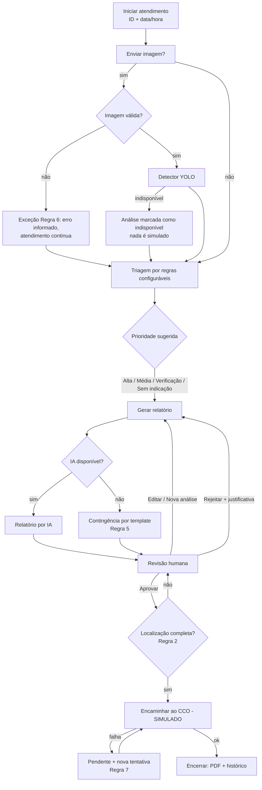

# Fluxo operacional — ORBE (Sprint 2)

## Problema
No atendimento pré-hospitalar rodoviário, informações da ocorrência (local, veículos, vítimas, riscos) são coletadas por rádio/telefone e registradas à mão, gerando atraso, dados incompletos e relatórios inconsistentes.

## Processo manual automatizado
Coletar dados → organizar → avaliar riscos olhando fotos → redigir relatório → revisar → comunicar ao CCO.

## Fluxo automatizado

## Etapas de uso
1. **Iniciar**: formulário (campos vazios viram “Não informado”).
2. **Análise**: upload validado (formato, tamanho, decodificação) e detecção.
3. **Triagem**: prioridade com motivos explícitos.
4. **Relatório**: 15 seções; IA redige resumo/encaminhamento, ou template.
5. **Aprovação humana**: aprovar, editar, nova análise ou rejeitar.
6. **CCO (simulado)**: só com relatório aprovado.
7. **Encerramento**: PDF, status e histórico.

## Pontos de decisão e regras
| Regra | Descrição |
|---|---|
| 1 | Indício de incêndio/capotamento (confiança ≥ 0,45) → prioridade **Alta**, sujeita à revisão |
| 2 | Localização incompleta → pendência; aprovação bloqueada até complementar |
| 3 | Baixa confiança → “Necessita de verificação”; aprovação exige justificativa |
| 4 | Sem aprovação → encaminhamento bloqueado |
| 5 | IA indisponível → template de contingência identificado, sem perda de dados |
| 6 | Imagem inválida → erro informado, atendimento segue |
| 7 | Falha no envio → ocorrência pendente, nova tentativa |

Limiares ficam em `config.py` (`TRIAGE`). Pessoas na imagem não implicam vítimas; o sistema não diagnostica.

## Aprovação humana e CCO
A decisão (responsável, data/hora, versão, justificativa) é gravada em `approvals`; alterações em `change_log`. A API (`/api/ocorrencias`) permite ao agente criar a ocorrência e gerar o relatório, mas **não** aprovar nem encaminhar. O envio ao CCO é uma simulação funcional, identificada na interface e no PDF.
